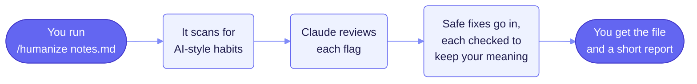
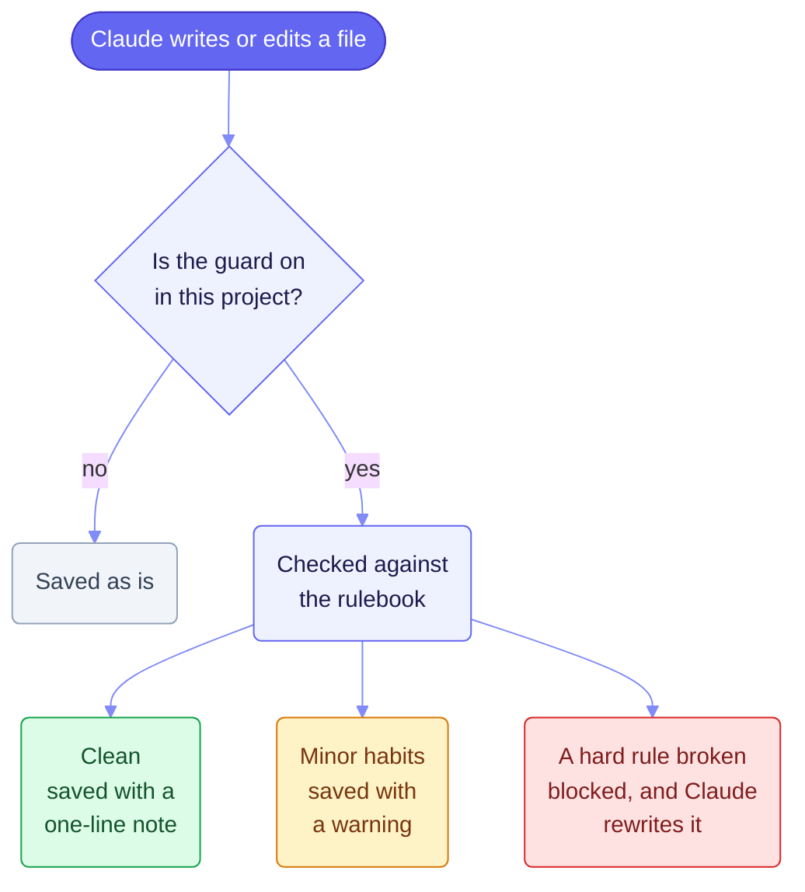
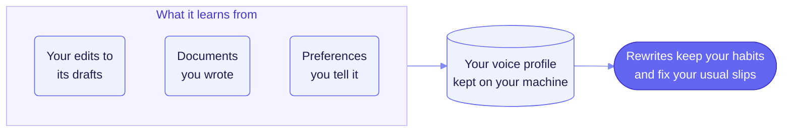

<div align="center">

# super-humanizer

**Takes the AI habits out of your writing and keeps what it says.**

A plugin for [Claude Code](https://code.claude.com/docs/en/overview)


<a href="#how-it-works"><kbd>How it works</kbd></a>
<a href="#install"><kbd>Install</kbd></a>
<a href="#use-it"><kbd>Use it</kbd></a>
<a href="#it-learns-your-voice"><kbd>Your voice</kbd></a>
<a href="#settings"><kbd>Settings</kbd></a>
<a href="#privacy"><kbd>Privacy</kbd></a>

</div>

---

AI drafts carry habits a careful reader spots at once: stock phrases, stacked hedges, tidy lists of
three, and punctuation no one types by hand. super-humanizer finds those habits, fixes the ones a
rule can fix safely, and tells you what it left for you and why.

## What it does

<table>
<tr>
<td width="33%" valign="top">

### Finds the tells

Scans documents, slide decks, spreadsheets, PDFs, code comments and prompts against a rulebook
of more than a hundred checks.

</td>
<td width="33%" valign="top">

### Fixes what is safe

Rewrites each flagged spot, then checks that every name, number, date and "not" survived. A
rewrite that changes the meaning is undone.

</td>
<td width="33%" valign="top">

### Explains the rest

Writes a short report of what changed, what it left for you with the reason, and anything it
could not read.

</td>
</tr>
</table>

## How it works



Anything the plugin is unsure about stays in the report under "Left for the human", with the
reason, so you make the call.

<details>
<summary><b>What a run does, file type by file type</b></summary>

<br/>

In a repository where you turn the guard on, the plugin scans every Write and Edit call to a
markdown, txt or prompt file as Claude composes it. A prompt file, such as `SKILL.md` or
`AGENTS.md`, goes to the prompt handler, which scans it under the prompt rules. A Python write
routes to the code handler, which scans its comments, docstrings and prose strings at the same
tiers. A JavaScript or TypeScript write routes through the same code handler.

A post-hoc run over an existing file, `/humanize report <path>` and then `/humanize <path>`,
detects, asks Claude its questions through a candidates file, applies the fixes a rule can make,
checks each rewrite for fidelity, and writes a report beside the file.

On a Python, JavaScript or TypeScript file the post-hoc run does the same over comments,
docstrings and prose strings. It runs the project's formatter and tests once before any write
back and once after, and restores the original bytes when either fails afterwards, which the
report's Validation section says as reverted. A code run executes the project's test suite twice,
once before and once after the write back, and each run may take up to 120 seconds. The Python
formatter and tests run under the project's own interpreter, and prettier and npm are found on
the path. That interpreter is the one in the project's `.venv` folder, else the one the
`VIRTUAL_ENV` variable names, else the interpreter that runs the plugin. When that interpreter
has no pytest, the tests read `not run` and name it, and the write back stands.

A post-hoc run over a slide deck, a spreadsheet, a Word document or a PDF reads it through its
own handler and reports what the handler cannot see. A judged run writes what it accepted into a
side-by-side copy, `<stem>.humanized<suffix>` beside the original, and for a PDF into
`<stem>.humanized.md`. By default it never writes the original. The `office_write` setting set to
`in-place`, or `--office-write in-place` on one run, writes a deck, a workbook or a Word document
itself and leaves no copy, and a PDF still gets its delivery. The guard never reads these files,
and a Write or Edit to one prints a note saying so.

</details>

## Install

**You need** Claude Code, Python 3.10 or later, and Git. On Windows that means Git for Windows,
since Claude Code runs the plugin's hooks through its Git Bash. Stock macOS ships Python 3.9,
which is too old.

1. **Install the plugin.** In a terminal, run:

   ```bash
   claude plugin install super-humanizer --marketplace gpgaoplane/super-humanizer --scope user
   ```

   Inside Claude Code, run `/plugin marketplace add gpgaoplane/super-humanizer` and then
   `/plugin install super-humanizer@gpgaoplane`.

   Install it at user scope, so the skill is there on request in every project you open. A
   project or local install limits the plugin to the one repository you installed it into.

2. **Add the readers for office files, PDFs and JavaScript.** Plain text and Python work without
   this step.

   ```bash
   pip install "python-pptx>=1.0" "openpyxl>=3.1" "python-docx>=1.1" "pypdf>=3" "lxml>=4" tree-sitter-language-pack pytest ruff
   ```

<details>
<summary><b>What each package does</b></summary>

<br/>

The scripts need only the Python standard library. The packages in that line read and write the
other file types.

`python-pptx` reads slide decks and writes their copy, `openpyxl` reads spreadsheets and writes
theirs, and `python-docx` reads Word documents and writes theirs. Under `office_write: in-place`
each writes into the file itself. `lxml`, which python-pptx and python-docx depend on, is named in
the line because the workbook's in-place write imports it by name, and an absent lxml refuses that
write with the package named. Without one of those three, a deck, a workbook or a document yields
no units and one cannot-see line naming the package and the pip line above. A `python-docx` older
than 1.1 or an `openpyxl` older than 3.1 reads the same way, and its line names the floor. Add
`--upgrade` to the pip line to raise one, since pip never upgrades a package already installed.

`tree-sitter-language-pack` reads a JavaScript or TypeScript file, and nothing else loads it.
Without it such a file yields no units and one cannot-see line naming the package. `pypdf` reads
a PDF's text layer, and nothing else loads it. Without it a PDF yields no units and one cannot-see
line naming the package.

`pytest` and `ruff` are the validation stage's optional tools. `pytest` runs a project's tests,
and when the interpreter that runs them has no pytest the tests read `not run`. `ruff` checks the
formatting of a project that configures it, and when it is missing the formatter reads `not run`.
For a JavaScript or TypeScript package the same stage runs `npm test` when `package.json` has a
`test` script and `prettier --check` over the script files when the package configures prettier,
both found on the path, and an absent one reads `not run` with the write left in place. The test
script `npm init` writes always fails, and the stage reads it as no test suite found.

</details>

<details>
<summary><b>How the plugin finds Python</b></summary>

<br/>

The hooks and the skill's commands run through `hooks/run-python.sh`, a short shell launcher. It
tries `python`, then `python3`, then the Windows launcher `py -3`, and uses the first one that
reports Python 3.10 or newer. It remembers that interpreter's path in the plugin's data folder and
looks again once the path is gone.

When no such Python is found, the writing guard is off. A hook says so once a day and lets the
write go ahead, and a `/humanize` command says so each time it runs. Install Python 3.10 or newer
and restart Claude Code.

On Windows the launcher needs Git for Windows, since Claude Code runs a hook's command through Git
Bash there. A Windows session without Git Bash runs hook commands through PowerShell, where `sh`
is missing, so the guard stays off in that setup.

</details>

<details>
<summary><b>Run it from a clone instead</b></summary>

<br/>

Clone this repository, then start Claude Code with `claude --plugin-dir` followed by the
clone's folder. This loads the plugin for one session, which suits working on the plugin itself.

</details>

## Use it

| You want to | Type this in Claude Code |
|---|---|
| Clean up a file | `/humanize notes.md` |
| See the flags and leave the file as it is | `/humanize report notes.md` |
| Guard every file Claude writes in this project | `/humanize on` (and `/humanize off` to stop) |
| Teach it your voice from documents you wrote | `/humanize learn ~/my-writing` |
| Teach it from your edits to one of its drafts | `/humanize retro draft.md final.md` |

<details>
<summary><b>All commands</b></summary>

<br/>

| Command | What it does |
|---|---|
| `/humanize <path>` | Cleans a file or a folder and writes back what it accepted. Add `--office-write in-place` to change a Word, PowerPoint or Excel file itself. |
| `/humanize report <path>` | Lists the flags and leaves the file as it is. |
| `/humanize on` | Turns the writing guard on for this project. |
| `/humanize off` | Turns the guard off. |
| `/humanize protect <pattern>` | Tells the plugin to leave matching text alone, such as a product name. |
| `/humanize learn <folder>` | Learns your voice from documents you wrote. `--recent NAME` marks your newest ones. |
| `/humanize retro <draft> <final>` | Learns from your edits to one of its drafts. |
| `/humanize retro state <kind> <entry>` | Records a preference you state, such as a word to avoid. |

</details>

## The writing guard

Turn the guard on with `/humanize on`, and every file Claude writes in that project is checked
before it is saved.



`/humanize on` writes `.humanize.json` at the repository root through `scripts/marker.py`, the
only writer of that file. Once the file exists, the Write and Edit hook reads it on every call in
that repository. A markdown, txt or prompt-file write is scanned before the tool call proceeds. A
Python write is scanned too, through the code handler, and its message says so. A JavaScript or
TypeScript write routes through the same code handler. Run
`/humanize off` to remove the file and turn the guard back off. The guard also reads commit
messages and pull request text before they go out.

A blocked write does not stay blocked forever. The hook counts refusals per session and file. A
write refused three times on the same file in one session turns into a permission prompt on the
fourth attempt, handing the decision to you. A refusal of the marker file or an overlay file
never counts toward this, and never turns into a prompt.

A scanned write is never silent. It prints one line, such as `super-humanizer: clean, strict` or
`super-humanizer: density light, general`. A write that prints nothing was not scanned. A write
to a deck, a workbook, a Word document or a PDF prints "this file is read by the post-hoc run
alone, so this write was not scanned" and goes through. A JavaScript or TypeScript write the
extractor could not read, because the tree-sitter package is absent, a grammar did not load or a
syntax error hid its strings, prints "nothing in this file was read" with the reason and goes
through, and never prints "clean".

The timeout in `hooks.json` is 10 seconds. A hook that runs past it is cancelled, and its output
is discarded. A write that lands with no message at all was not scanned, because a cancelled
hook's output never reaches you.

<details>
<summary><b>Under <code>strict</code></b></summary>

<br/>

Under `strict`, a mark is a violation on sight, and the hook scans the whole resulting file on
every Edit and never just the changed lines. So a file that already carried marks before the
plugin was turned on refuses every Edit call, until something cleans the file. The post-hoc run is
the fix: `/humanize report <path>` asks the questions, you answer them in the verdicts file, and
`/humanize <path>` applies the answers and the fixes a rule can make. A judged run that leaves any
question unanswered changes nothing and names what to answer. `/humanize off` remains the escape
for the times you need to keep working before a cleanup: it removes the marker so Edit calls go
through unscanned again.

</details>

## It learns your voice

Set `"voice": "mine"` in the project's `.humanize.json`, and rewrites follow a profile of how you
write. Edit that file yourself, since the guard stops Claude from changing it.



A habit takes effect once it shows up in two separate pieces of work, or the moment you state it.
The profile lives in `~/.claude/super-humanizer/`, outside your projects.

<details>
<summary><b>The voice profile in full</b></summary>

<br/>

### The voice profile

A learned voice profile, when one exists, lives at `~/.claude/super-humanizer/`, a plain user path
no plugin command touches, so an uninstall leaves it in place. The folder holds the profile,
`voice-profile.json`, and the ledger beside it, `ledger.jsonl`. The setting `SUPERHUMANIZER_HOME`
names another folder for both, and a leading tilde in it reads as your home folder. Setting
`voice` to `mine` in the marker before a profile exists warns `no profile learned yet`, in the hook
and in the post-hoc report alike. The post-hoc report adds a hint to that line and to its Cannot
see list that names the learn command and says nothing runs until you name a folder. A `voice`
value other than false and `"mine"` warns and reads as false.

A retro learns the profile from your own edits. `/humanize retro <draft> <final> [--task NAME]
[--until TEXT]` reads the draft the plugin helped with and the final you settled on, each a
markdown, txt or docx file, and refuses any other suffix with the three named. It aligns the two
by bullet, then writes `<draft>.humanize-retro.json`, one question per divergence, and
`<draft>.humanize-retro-report.md` beside the draft, and prints the report. `--task` names the task
in each ledger row and defaults to the sha256 of the draft's bytes, so two drafts that share a file
name keep their rows apart. Name the task yourself when you run the retro on a revised draft of one
piece of work, since a confirmation needs two different tasks and a revised draft would count as a
second one by its bytes. `--until` cuts both sides at the first heading that holds the text, so an
appendix of citations is left out.

Run the retro, then answer the questions file under the Retro section of
`references/judgment-checklist.md` by writing `<draft>.humanize-retro-verdicts.json`, copying the
questions file's `retro_digest` across, then run the same retro again. That run appends one ledger
row per divergence, moves the verdicts file aside to
`<draft>.humanize-retro-verdicts.applied-<UTC stamp>.json`, and writes the profile whole from the
whole ledger. A second apply of the same file adds nothing. A verdicts file the run refuses leaves
the ledger as it was, stays beside the draft, and has its reason in the report's Cannot see
section, and the run exits 1.

An entry sits at watch on one ledger row and at confirmed on two rows from two different tasks, on
two identical edits, each with a before and an after, from two tasks, or on a stated preference,
and rows from one task alone keep it at watch however many there are. A row with no task counts
toward no task. `/humanize retro state <kind> <entry>` records a stated preference, the kind one of
diction, mark, device, structure and avoid, and writes it as a confirmed entry at once. A
preference enters through `retro state`. A hand edit to the profile lasts until the next retro or
`retro state`, which writes the profile whole from the ledger and names each entry the file held
that the harvest dropped.

The profile can also learn from documents you wrote yourself. `/humanize learn <folder> [--recent
NAME ...] [--until TEXT]` reads every markdown, txt, Word and PDF file in the folder in place and
read-only, writes nothing beside them, reads documents with equal texts once, groups documents
into one task at a word-set Jaccard of 0.35 or above, and writes one questions file for each
document it reads under `~/.claude/super-humanizer/learn/<document digest>/`, with the recent list
at `learn/recent.json` and the report at `learn/learn-report.md`. `--recent` names the documents
you wrote recently by their file names, matched exactly and with regard to case, and rewrites the
list whole, while no names leave it as it was. A name the folder lacks, a name in another case and
a name that names a file the run did not read each refuse the run before any write. `--until` cuts
each document at the first heading holding the text, and on a PDF at the first page whose text
opens on it. The run reads the general rulebook with its overlay, whatever the marker says, and
prints a report with ten sections: What ran, Documents, Tasks, Recency, Candidates, Ledger,
Profile, Older only, Cannot see and Limits.

Run the learn command, then answer each document's questions file under the Learn section of
`references/judgment-checklist.md` by writing `verdicts.json` beside it under
`~/.claude/super-humanizer/learn/<document digest>/`, copying the questions file's `learn_digest`
across, then run the same learn command again. That run appends one ledger row per trait, moves
each spent file aside to `verdicts.applied-<UTC stamp>.json`, and writes the profile whole from the
whole ledger. A file the run refuses as stale or malformed leaves the ledger as it was, has its
reason in the Cannot see section with the half or the trait named, and a fresh questions file is
written to answer again. A second apply of the same file adds nothing. Naming documents recent with
no new verdicts rewrites the recent list and, when the ledger already holds a row a learn run
appended, harvests the profile again, so recency moves and nothing else. A document the ledger
already holds under another task id, which happens when another document joins its family after it
was learned, refuses the whole family before any append, and a family that changes shape needs a
fresh home. A document you open and save again between two learn runs keeps its task, since the run
reads the earlier bytes' questions file under the home and groups the two, and its earlier rows
stay under the earlier digest. That holds while the ledger has the family under one task and the
earlier questions file is still under the home, and when that file is gone the run says so in
Cannot see and the re-saved document starts a task of its own.

Under `mine` with a profile read, the report's What ran line counts the entries in force by kind
and says silences and licences are off under `strict`. The candidates file carries a `voice` block
with a prefer list, a licences list and an avoid list that a rewriting model follows, and a slips
list when a confirmed slip entry is in force, the forms the model corrects and never imitates. A
mark entry whose glyph no density rule counts sits in the prefer list under `general`, and an entry
backed by a document named recent comes first in each list. The question digest covers the profile
file, so a profile changed between `report` and the apply refuses the verdicts file. A watch entry
layers nothing and changes only the question digest. A confirmed entry with a silences list lowers
its own density count under `general`, in the hook and in the post-hoc report. Under `mine` with a
profile present, a model rewrite that changes more than the `refine_cap` share of a unit's words is
reverted with a Cap line in the report's Rewrites applied section, and a substitution fix is never
capped.

</details>

## Works with

| Writing | Code | Office | PDF |
|---|---|---|---|
| Markdown, plain text and prompt files | comments, docstrings and messages in Python, JavaScript and TypeScript | Word, PowerPoint and Excel | the text layer |
| fixed in place | fixed in place, then your formatter and tests run | a cleaned copy beside the original | a cleaned markdown copy |

## Settings

Each repository keeps its settings in `.humanize.json` at its root, which `/humanize on` writes.
Edit it yourself, since the guard stops Claude from changing it.

| Key | What it sets | Default |
|---|---|---|
| `rulebook` | `general`, which follows plain-language style guides, or `strict`, which blocks AI-style punctuation on sight | `general` |
| `voice` | `"mine"` to rewrite in your learned voice | `false` |
| `include`, `exclude` | the files a run and the guard read | text, script and office files in, generated and vendored files out |
| `prompt_globs` | the files read as prompts | agent folders, `AGENTS.md`, `SKILL.md` and `CLAUDE.md` |
| `protect` | text to leave alone, such as a product name | none |
| `office_write` | where a judged run writes a deck, a workbook or a Word document | `copy` |
| `second_reader` | a second, independent judgment on office files and long documents | `auto` |
| `refine_cap` | how much of a unit's words a rewrite in your voice may change | `0.35` |

The default include globs cover `**/*.pptx`, `**/*.xlsx` and `**/*.docx` beside the text and script
suffixes. A directory run therefore leaves a report, a candidates file and, under
`second_reader: auto`, a brief beside every deck, workbook and Word document it reads, and a run
that accepted a rewrite leaves the copy as a fourth file. A folder of 20 office files therefore
gains 60 files from a report run and 80 once a judged run has written a copy of each. A judged run
under `office_write: in-place` leaves those three alone, since it writes the file itself, so the
folder stays at 60. The default exclude globs keep these files out of the next run,
`**/*.humanized.*` for a copy and the report, candidates, verdicts and brief shapes for the rest,
and `**/~$*` keeps out an office lock file. `**/*.humanize-retro*.json` and
`**/*.humanize-retro-report.md` keep a retro's files out of every run and out of the hook. A file
the run could not read gets the report alone. No default include glob carries a PDF. `**/*.pdf` is
an opt-in the marker's `include` list takes, and a PDF named directly is always read.

The marker's `office_write` key sits beside the include globs. It holds `copy`, the default, or
`in-place`, and decides where a judged run writes a deck, a workbook or a Word document. `copy`
writes the side-by-side copy. `in-place` replaces the changed parts of the file itself through a
temporary file beside it and one rename, so a failure at any step leaves the original's bytes as
they were, and it leaves no copy. A value outside the two warns and takes `copy`.
`/humanize <path> --office-write in-place` sets it for one run when the repository has no marker to
edit. A PDF is never edited in place. `**/*.humanize-tmp.*` is in the default excludes, so a
temporary file a crash leaves is never read as an artifact.

The marker's `refine_cap` key caps how much of a unit's words a model rewrite may change under
`voice: "mine"` with a profile present. The default is 0.35 and the range is above 0 and at most 1.
A value outside the range, or a value that is no number, warns and takes 0.35. The key changes
nothing under `voice: false` or under `mine` with no profile.

## Privacy

- **No network calls.** The plugin's scripts make no network call, and they never call a model.
  Claude, in your own session, makes each judgment, and every judgment is saved to a file beside
  your document that you can read.
- **What it runs.** The hooks run on Claude's Write and Edit calls, on shell calls that start with
  `git` or `gh`, and on PowerShell calls. Each goes through `hooks/run-python.sh`, which starts the
  plugin's own Python scripts. A run asks `git` read-only questions to find a repository's root and
  the files a branch changed. After a change to code it runs your project's formatter and tests:
  `ruff` or `black` and `pytest` for Python, and `prettier` and `npm test` for JavaScript and
  TypeScript.
- **What it writes.** A report and a candidates file beside each document it reads, and the
  verdicts file Claude writes there. A cleaned copy beside a deck, a workbook, a Word document or a
  PDF. The voice profile and its ledger in `~/.claude/super-humanizer/`. In the plugin's data
  folder, the refusal count, the rulebook overlay and the Python path the launcher found.
- **Your voice stays on your machine.** The profile and its ledger live in
  `~/.claude/super-humanizer/` and nowhere else.
- **Your project's own tools run as they always do.** After a change to code, the plugin runs
  your formatter and your tests, and they do whatever your project set them up to do.

## Good to know

- **It never claims text is undetectable**, and it never invents a fact to make a sentence work.
- **Code stays safe.** After a change to code, your formatter and tests run, and a failure puts
  the original back.
- **Two rulebooks.** `general` is the default and follows plain-language style guides. `strict`
  is stricter and blocks AI-style punctuation on sight.

> **Status.** Version 1.4. Every feature above is built and tested. The voice profile's effect on
> rewrites was measured once and has not yet shown a gain, so real use will tell.

## Limits

Each of these is a case where the guard does less than you might assume.

- Managed settings can block plugin hooks entirely through `allowManagedHooksOnly`.
- `disableAllHooks` turns every hook off.
- Whether workspace trust holds plugin hooks back is undocumented. An interactive session holds
  settings-file hooks back until the trust dialog is accepted, and a `-p` or SDK session treats
  the folder as trusted.
- A timed-out hook's output is discarded, so the fail-open notice cannot cover a timeout.
- The inline gate sees Write and Edit calls only. A shell write is never scanned, and the
  FileChanged event cannot block it.
- A model can run `marker.py` itself, so the marker guard is a speed bump. The report prints the
  marker's state on every run.
- Hook scripts run with the user's full permissions.
- Hook output is capped at 10,000 characters, and output over the cap goes to a file with a
  preview.
- Under `strict`, a file written before the plugin was turned on refuses every Edit until a
  post-hoc run cleans it.
- The tests mention in the Validation scope is a literal substring search of the test files for
  each edited unit's text, so a short unit can match by accident.
- A file a project's prettier ignores is never checked, and the formatter stage reads pass for
  it, as the project's own check would.
- Under CI=1, which the validation stage sets for npm test, a jest run that needs a new snapshot
  fails, so such a package reads fail before any rewrite.
- A class list passed through a member call on a helper object, an array, or a cva variant value
  is read as a prose string, since C145 catches the bare clsx, cn, classNames and cva calls alone.
- The overlay guard asks whether the folder Claude is working in carries a marker, so an overlay
  written from an unmarked session is allowed through.
- The commit hook reads these message forms. A `git commit` message comes through one or more `-m` flags, the `--message` forms, or `-F` and `--file` on a file that exists, and `-F -` reads its heredoc. A `-m` message is a quoted string, a PowerShell here-string, a bare word, or the `` `$(cat <<'EOF' ... EOF)` `` form. `gh pr create`, `gh pr edit` and `gh pr merge` are read the same ways. A message in any other form gets a note saying it was not scanned, and so does a `bash -c`, `sh -c`, `pwsh -Command` or `cmd /c` wrapper around a git or gh call. Some shapes still pass with no output, among them `eval`, `xargs`, a git alias, a git call inside a command substitution such as `$(git ...)`, a commit in another repository reached by `git -C`, `git merge -m` and `git tag -m`.
- The PowerShell handler carries no filter, so every PowerShell call starts Python once, whether
  or not the call holds a commit.
- A semicolon glued inside or after a bare URL is read as part of the URL and masked with it,
  unless it ends the URL. A dash, an arrow, a middle dot or a vertical bar ends a URL and is
  checked as usual.
- File names match without regard to case on Windows and macOS, and with regard to case on Linux.
- A Windows short file name, such as `HUMANI~1.JSO`, can reach the marker past the guard.
- The refusal count lives in a state file under the plugin data folder, which the Write tool can
  reach. A session could seed a count and turn a first refusal into a permission prompt you still
  answer.
- The voice profile at `~/.claude/super-humanizer/` is writable too. A confirmed entry with a silences list, a word as well as a mark, lowers its own density count under `general` and does that under no other rulebook. A slip entry, as an avoid entry, silences nothing. Every judged retro and every `retro state` writes the profile whole from the ledger, so a hand edit lasts until the next one, and that run's report names each entry the file held that the harvest dropped.
- A plugin loaded with `--plugin-dir` has no guard on its own files.
- The guard watches the Write and Edit tools. `NotebookEdit` is left out on purpose, since a
  notebook file sits outside the include globs, which by default cover markdown, txt, Python and
  the JavaScript and TypeScript suffixes, and the office suffixes. `MultiEdit` is no Claude Code
  tool, so it needs no matcher.

## Credits and license

super-humanizer is released under the MIT License. See [LICENSE](LICENSE), and
[NOTICE](NOTICE) for the licenses of the sources below.

<details>
<summary><b>Sources</b></summary>

<br/>

**Open-source projects**

- [blader/humanizer](https://github.com/blader/humanizer), Siqi Chen, MIT
- [hardikpandya/stop-slop](https://github.com/hardikpandya/stop-slop), Hardik Pandya, MIT
- [petergyang/no-ai-slop](https://github.com/petergyang/no-ai-slop), Peter Yang, MIT
- [dmmulroy/anti-slop](https://github.com/dmmulroy/anti-slop), Dillon Mulroy, MIT
- [Aboudjem/humanizer-skill](https://github.com/Aboudjem/humanizer-skill), Adam Boudjemaa, MIT
- [jpeggdev/humanize-writing](https://github.com/jpeggdev/humanize-writing), jpeggdev, MIT
- [harshaneel/humanize](https://github.com/harshaneel/humanize), Harshaneel Gokhale, MIT
- [lynote-ai/humanize-text](https://github.com/lynote-ai/humanize-text), Lynote.ai, MIT
- [Hello-SimpleAI/chatgpt-comparison-detection](https://github.com/Hello-SimpleAI/chatgpt-comparison-detection), the HC3 corpus
- Skill pages read for ideas: [reduce-ai-perception-v2](https://skillhub.cn/skills/user_ab5ae6ee/unclecheng-reduce-ai-perception-v2),
  [deslop](https://skillsmp.com/creators/openclaw/openclaw/agents-skills-deslop) and
  unslop, from cursor/plugins on the skills.sh directory

**Research**

- Kobak and others, excess vocabulary in biomedical writing, [arXiv 2406.07016](https://arxiv.org/abs/2406.07016)
- Liang and others, LLM use in scientific papers, [arXiv 2404.01268](https://arxiv.org/abs/2404.01268)
- Liang and others, AI-modified peer reviews, [arXiv 2403.07183](https://arxiv.org/abs/2403.07183)
- Astarita and others, ChatGPT in astronomy papers, [arXiv 2406.17324](https://arxiv.org/abs/2406.17324)
- Geng and Trotta, academic writing style, [arXiv 2404.08627](https://arxiv.org/abs/2404.08627)
- Four studies of LLM-generated code: [2510.03029](https://arxiv.org/abs/2510.03029),
  [2508.21634](https://arxiv.org/abs/2508.21634), [2605.13280](https://arxiv.org/abs/2605.13280)
  and [2605.02741](https://arxiv.org/abs/2605.02741)

**Style guides and documentation**

- [Wikipedia: Signs of AI writing](https://en.wikipedia.org/wiki/Wikipedia:Signs_of_AI_writing)
- [Federal plain language guidelines](https://digital.gov/guides/plain-language),
  [Google developer style guide](https://developers.google.com/style) and
  [Microsoft Writing Style Guide](https://learn.microsoft.com/en-us/style-guide)
- [Anthropic prompt engineering guide](https://platform.claude.com/docs/en/build-with-claude/prompt-engineering/overview)
- Claude Code docs on [hooks](https://code.claude.com/docs/en/hooks),
  [plugins](https://code.claude.com/docs/en/plugins) and [skills](https://code.claude.com/docs/en/skills)

</details>

For what each part of a report means, see [references/report-format.md](references/report-format.md).
The steps Claude follows on each run are in [skills/humanize/SKILL.md](skills/humanize/SKILL.md).
